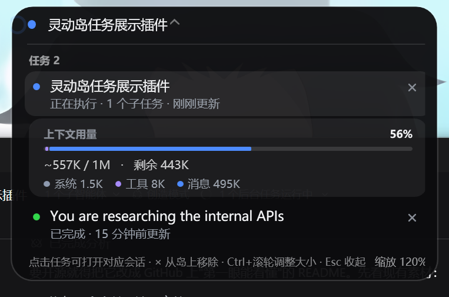
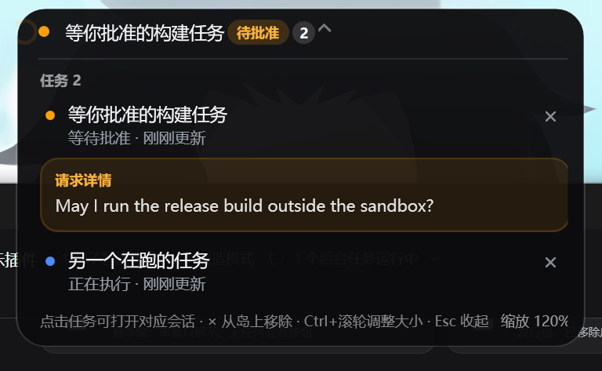

# 灵动岛 · DSH Dynamic Island

> 给 [DSH](https://github.com/deepseek-ai) 桌面版做的**桌面级任务悬浮窗**：屏幕顶部中央一颗小胶囊，
> 一屏之内告诉你现在有几个任务在跑、谁的上下文快满了、谁在等批准；鼠标停上去展开成详情卡，
> 没任务时它就是一块安静的黑色小方块，绝不挡你的界面。

<p>
  
  
  
  
  
</p>



| 待批准请求只读展示（挂在对应任务下方） | 长标题会截断，徽章与箭头始终完整 |
| --- | --- |
|  |  |

---

## 目录

- [它能做什么](#它能做什么)
- [环境要求](#环境要求)
- [快速开始](#快速开始)
- [怎么用](#怎么用)
- [可配置项](#可配置项)
- [它是怎么工作的](#它是怎么工作的)
- [隐私与安全](#隐私与安全)
- [参与开发](#参与开发)
- [仓库结构](#仓库结构)
- [已知边界](#已知边界)
- [实现细节](#实现细节)
- [许可](#许可)

## 它能做什么

**收起状态**（顶部居中，深色圆角胶囊 + 投影，与系统主题无关）：

| 情况 | 显示 |
| --- | --- |
| 有请求在等你 | 该会话标题 + 橙色徽标（`待批准` / `待回答` / `待确认`） |
| 一个任务在跑 | 该任务标题；没有标题时退回工作目录名 |
| 多个任务在跑 | `N 个任务正在执行` + 数量角标 |
| 只有刚结束的任务 | `N 个任务已完成` |
| 什么都没有 | 一块 108×30 的纯黑小胶囊（`--always-show`，不带任何文字） |

DSH 桌面版退出或数据接口持续断开 5 秒后，桌面悬浮窗会隐藏；重新打开 DSH 后会恢复显示。

**展开状态**（鼠标移入，或键盘聚焦；移出 200 ms 后收起）：

- **任务列表** —— 所有「正在执行 / 等待处理 / 未读完成」的会话，等待处理的排最前；每行有状态点、
  标题、状态文案（`正在执行 · 2 个子任务`、`等待批准`）和 `N 秒前更新` 相对时间。
- **上下文用量** —— 鼠标在某条任务上**停满约 1 秒**，就在**那条任务下面**展开它自己的用量：
  `上下文用量 57%`、`~557K / 1M · 剩余 443K`，加一条按 **系统 / 工具 / 消息** 三段着色的进度条与图例。
  占比 ≥85% 时百分比转告警色。数据直接取官方上下文计量器的同一份投影（`contextPressure` +
  `contextBreakdown`），不是估算。
- **请求详情** —— 待处理请求挂**在它自己的任务下面**：审批显示理由原文（`displayReason` 的当前语言 →
  `reason` → 工具名），提问/计划确认显示问题文本。**只读展示**，不含任何应答按钮（见下）。
- **点击某一行** —— 把 DSH 窗口带到前台（最小化也会先恢复）并切换到该会话。
- **行内 `×`** —— 只把这一条从岛上移除；它重新开始一轮或有新交互时会再出现。

**不用鼠标也能用**：`Enter`/点击固定展开，`Esc` 收起，`Ctrl + 滚轮` 缩放（0.7×–2.5×，立即记忆）。

## 环境要求

| | |
| --- | --- |
| 系统 | Windows 10 / 11（悬浮窗是 WPF，Windows 专用） |
| 运行时 | .NET Framework 4.8（Win10/11 自带） |
| 编译器 | 任意 C# 编译器：脚本会先找 VS 2022 的 Roslyn `csc.exe`，再退到 `%WINDIR%\Microsoft.NET\Framework64\v4.0.30319\csc.exe` |
| 宿主 | DSH 桌面版（开发时验证于 0.2.0-rc.2），配置档案默认 `desktop` |
| 可选 | Node.js 18+（只有跑测试和开发脚本需要） |

## 快速开始

> 不想编译就地取材：从 [Releases](../../releases) 下载打包好的 zip，解压后运行 `install.ps1` 即可。

```powershell
git clone <this-repo> dsh-plugin-dynamic-island
cd dsh-plugin-dynamic-island

# 1) 装插件：往 DSH 档案的 cordis.patch.yml 里写入一段带标记的 insert 行
powershell -NoProfile -ExecutionPolicy Bypass -File .\install.ps1

# 2) 编译并启动桌面悬浮窗（install.ps1 默认已经帮你启动）
powershell -NoProfile -ExecutionPolicy Bypass -File .\overlay\build.ps1
.\overlay\start-island.cmd
```

之后**打开 DSH 就会自动拉起悬浮窗**（插件行加载时检查一次，已经在跑就不重复启动）；想关掉这个行为，
在 Loader 行配置里写 `autoStartOverlay: false`。

卸载：

```powershell
powershell -NoProfile -ExecutionPolicy Bypass -File .\uninstall.ps1   # 顺手停掉悬浮窗并移除自启
.\overlay\stop-island.cmd
```

## 怎么用

| 操作 | 效果 |
| --- | --- |
| 鼠标移到胶囊上 | 展开任务卡片 |
| 在某条任务上停约 1 秒 | 在那条任务下面展开它自己的上下文用量（快速划过不会闪出来） |
| 点击某条任务 | DSH 窗口跳到最前并切到该会话（最小化会先恢复） |
| 点任务右侧的 `×` | 把这条任务从岛上移除 |
| 看到「请求详情」卡 | 只是**告诉你**有东西在等批准；批准/拒绝请回 DSH 窗口操作，岛上没有应答按钮 |
| `Ctrl` + 滚轮 | 调整岛的大小（记住，存在 `overlay\island.settings.json`） |
| `Esc` | 收起卡片 |

> **审批：只展示，不应答。** 这是刻意的设计。宿主半边记录待审批请求后原样调用 `next()`，
> 官方 UI 依旧是**唯一**的应答者；岛上那张卡把理由摆出来让你不用切窗口就知道"有东西卡住了"，
> 但它不会、也无法替你批准任何东西。插件对会话是**完全只读**的。

## 可配置项

**DSH 插件**（写在该 Loader 行的 `config` 里，全部可选）：

| 键 | 默认 | 说明 |
| --- | --- | --- |
| `port` | `19391` | 宿主快照接口的首选端口（占用则顺延，最多试 5 个） |
| `discoveryPath` | `%USERPROFILE%\.dsh\dynamic-island.json` | 接口地址的公告文件 |
| `autoStartOverlay` | `true` | 插件加载时自动拉起悬浮窗（已在跑则跳过） |
| `overlayPath` | `<插件目录>\overlay\DynamicIsland.exe` | 想用别处的可执行文件时指定 |
| `overlayArgs` | 与 `start-island.cmd` 一致 | 自动拉起时传给悬浮窗的参数 |
| `enabled` | `true` | 设 `false` 保持挂载但不工作 |
| `showInPage`（客户端） | `false` | 是否同时在 DSH 页面里画一份胶囊（默认只在桌面上画） |

**悬浮窗**（命令行）：

| 参数 | 说明 |
| --- | --- |
| `--always-show` | 没有任务时也保持显示（画成一块纯黑小胶囊） |
| `--hide-on-disconnect` | DSH 数据源连续 5 秒不可用时隐藏悬浮窗；重新收到数据后恢复 |
| `--hover-delay <ms>` | 悬停多久才展开用量块，默认 `1000`；设 `0` 立刻展开 |
| `--idle-hide <ms>` | 空闲多久后隐藏（默认 `0` = 不隐藏） |
| `--scale <n>` | 本次运行的缩放（也可 `Ctrl` + 滚轮，会写入设置文件） |
| `--port <n>` / `--url <u>` / `--focus-url <u>` / `--discovery <f>` | 接口相关覆盖项（调试用） |
| `--settings <f>` / `--report <f>` / `--log <f>` | 个人设置 / 状态快照 / 日志的位置 |

## 它是怎么工作的

```
DSH 页面（浏览器半边）                                桌面悬浮窗（overlay/DynamicIsland.exe）
  ├─ useSessions / useSessionStatus                    ├─ 监听 127.0.0.1:19391（占用则 19392…）
  ├─ ctx.jobs 后台任务轮询                              ├─ POST /island  ← 页面每秒推送的快照
  └─ 每秒 POST 快照 ─────────────────────────────────► ├─ GET  /focus   → 点击要打开的会话
                                                       └─ 最顶层小窗渲染（不抢焦点）
                                     ▲
    宿主半边（在 DSH 进程内）          │ 发现文件 %USERPROFILE%\.dsh\dynamic-island.json
    ctx.agents / sessions /            └─ 页面关掉后仍可提供同一份 JSON
    sessionProjections / jobs
```

三块东西各管一段：

| 部分 | 位置 | 作用 |
| --- | --- | --- |
| **浏览器半边** | `lib/client.js` | 读实时会话目录、待处理交互、后台任务队列；每秒把「它正在渲染的东西」推给悬浮窗；把悬浮窗的点击要回来的会话切到前台 |
| **宿主半边** | `lib/impl.js` + `collect.js` + `server.js` | 在 DSH 进程里读 Agent 注册表/会话投影/任务注册表，旁听 `approval/request`（不消费），对外提供同一份 JSON —— 页面关掉后的兜底数据源 |
| **桌面悬浮窗** | `overlay/DynamicIsland.cs` | 单文件 C#/WPF：最顶层、不激活、点击穿透的窗口 + 自建回环 HTTP + 全部渲染与动画 |

几个刻意的选择：

- **窗口固定为最大外框，只有胶囊在里面变形。** 动画只改变胶囊的宽度/高度/内边距（`CubicEase`，
  展开 280 ms / 收起 200 ms），窗口本身不重设尺寸，所以变形期间不会闪、也不会抖。
- **目标没变就什么都不做。** 每秒一次的快照只有在真正需要时才启动动画——这是"悬停不再闪烁"的根因修复。
- **文字用 Ideal 渲染。** 中文走回退字体，`Display` 的网格对齐在这个窗口的设备尺寸下会丢掉字的下半截笔画。
- **透明边距留 16 DIP。** 卡片 1px 边框和圆角不会正好压在窗口边界上被削掉。

## 隐私与安全

- 所有接口**只绑 `127.0.0.1`**，不监听外网、不联网、不回传任何数据。
- 插件对会话**只读**：不激活、不恢复、不回答、不修改任何会话状态。
- 审批请求只是被"旁听"（记录后原样 `next()`），官方 UI 的应答流程完全不受影响。
- 唯一的写操作是把发现文件写到 `%USERPROFILE%\.dsh\`，以及悬浮窗自己的设置/日志文件。

## 参与开发

隔离测试（不需要 DSH 在场）：

```powershell
node dev\component-test.mjs     # 56 项：字典、槽位注册、悬停展开/收起、点击、键盘、推送桥、让位逻辑、用量字段
node dev\autostart-test.mjs     # 12 项：打开 DSH 自动拉起悬浮窗——健康标记识别、不重复启动、启动参数与工作目录
node dev\server-test.mjs        # 19 项：本地接口路由、CORS、焦点队列、端口回退、异常容错
node dev\collect-test.mjs       # 32 项：宿主快照（运行/审批/提问/后台任务/子任务/完成窗口/TTL）
node dev\host-half-test.mjs     # 18 项：真实宿主半边挂载 → 接口 → 审批旁听 → 焦点桥 → 释放
```

真实窗口的端到端检查（需要 Windows 桌面，会真的开窗、真的移动指针）：

```powershell
powershell -NoProfile -ExecutionPolicy Bypass -File overlay\overlay-live-test.ps1
# 59 项：推送后出现、居中置顶、不抢焦点、标题变短变窄、空闲状态、--always-show 空态黑块、
#        --idle-hide 退休、悬停满约 1 秒才展开对应任务的用量、离开即收起、行内 × 只移除该任务、
#        待批准请求在对应任务下方成卡（只读、无应答按钮）、点击任务把会话写进本机队列且只交付一次、
#        点击后窗口真的到前台并可从最小化恢复（用替身窗口验证）、Ctrl+滚轮缩放并落盘、
#        稳定态不重启动画（防闪烁）、变形期间窗口尺寸恒定、渲染时钟驱动与帧间隔、指针停留期间不收起
```

合计 **196 条断言**。指针被真人移开导致样本不足时，测试打印 `SKIP` 而不是误报失败。

调试辅助：

```powershell
node dev\mock-push.mjs 19409 approval      # 假数据驱动悬浮窗（usage / rows / approval / empty 四种场景）
powershell -File dev\harness-stub.ps1 -Seconds 20
                                           # 替身 Harness 窗口，验证"点击后前台切换"而不打扰真实窗口
powershell -File overlay\capture-island.ps1 -Hover -Report <状态文件>
                                           # 悬停后按胶囊实际尺寸截图，并打印四角/中心像素
```

改代码后怎么生效：

- `lib/client.js`（页面半边）→ 用 Plugin Manager 停用再启用该行，或页面按 F5。
- `lib/impl.js`（宿主半边）→ `node dev\reload-host.mjs` 发布一个修订版，再停用/启用该行，**不需要重启 DSH**。
- `overlay/DynamicIsland.cs` → 先停悬浮窗（Windows 会锁定正在运行的 exe），再 `build.ps1`，再启动。

## 仓库结构

```
dsh-plugin-dynamic-island/
├─ package.json              # main/exports + dsh.client.platform=web
├─ install.ps1 / uninstall.ps1
├─ lib/
│  ├─ boot.js                # 稳定的 Loader 入口：按 revision.json 加载实现（宿主热重载）
│  ├─ index.js               # 包入口，转出 apply
│  ├─ impl.js                # 宿主半边：接口 + 审批旁听 + 诊断状态文件
│  ├─ server.js              # 回环 HTTP 接口（/island、/health、/focus）+ 发现文件
│  ├─ collect.js             # 宿主快照：agents / sessions / 投影 / jobs / 审批旁听
│  ├─ host-autostart.js      # 打开 DSH 时确认/拉起悬浮窗
│  ├─ client.js              # 浏览器半边：样式 + 组件 + shell.overlay 注册 + 推送桥
│  └─ revision.json          # 宿主半边当前实现修订号
├─ overlay/
│  ├─ DynamicIsland.cs       # 全部窗口/渲染/接口逻辑（单文件，无 XAML）
│  ├─ build.ps1              # Roslyn csc 编译；检测正在运行的实例
│  ├─ start-island.cmd / stop-island.cmd
│  ├─ setup-autostart.ps1    # 开机自启开关
│  ├─ overlay-live-test.ps1  # 真实窗口的端到端检查
│  └─ capture-island.ps1     # DPI 感知的截图工具
├─ dev/                      # 开发辅助（不参与运行）
├─ docs/                     # 截图
└─ dist/                     # 打包产物（dev/pack.ps1 生成，见 Releases）
```

## 已知边界

- **宿主半边要等 DSH 重启才生效。** 运行中的 App 会把补丁应用到 Loader 行树，但不会为新插入的行
  导入模块。所以：现在数据由**页面推送**提供（DSH 页面开着即可，最小化也行）；重启 DSH 后宿主半边
  开始提供同一份 JSON，页面关掉也有数据。
- **审批无法从岛上传送。** 一条审批由"收到它的应答者"持有；DSH 没有对外暴露"改写已挂起审批"的接口，
  所以岛上不做应答按钮。这是设计上的取舍，不是未完成的功能。
- **平台**：悬浮窗是 Windows 专用（WPF + .NET Framework 4.8）；插件本身与平台无关。
- **缩放读数**：窗口以物理像素呈现（WPF 逻辑单位 × DPI 缩放），150% 缩放下看到的像素数约是逻辑值的 1.5 倍。
- **本仓库是第三方项目**，与 DeepSeek 官方无关；它只使用 DSH 公开的插件接口与服务，不修改 DSH 本体。

## 实现细节

<details>
<summary>点开看设计笔记（动画、悬停、用量、焦点、热重载…）</summary>

**岛只出现在桌面上。** 页面那份胶囊（`shell.overlay`）默认**不渲染**，要显式配置 `showInPage: true`
才会出现——它本来就会压在应用自己的界面元素上。页面仍照常把数据推给桌面悬浮窗，只是自己不再画东西。

**DSH 运行期间悬浮窗常驻。** `start-island.cmd` 用 `--always-show --hide-on-disconnect` 启动：没有任务时只画一块
108×30 全圆角黑块（没有文字、没有图标、也不展开）；DSH 退出或数据接口连续 5 秒不可用后会隐藏，重新收到数据时恢复。

**打开 DSH 自动拉起悬浮窗。** 宿主半边跑在 DSH 进程里，插件行一加载就按悬浮窗自己的 `/health` 标记
（19391–19395 依次探测）确认它是否在跑：在跑就不动，没在跑就以 `--always-show --hide-on-disconnect …` 启一个独立进程。
进程与 DSH 解耦，断连时先隐藏，便于 DSH 重开后通过同一进程恢复。

**完成的任务会留在岛上，由你用 `×` 清掉。** 页面把最近 30 分钟内动过的已完成会话也送过来（最多 6 条），
不再"开新任务就把旧的挤掉"。

**上下文用量跟随任务，悬停满 1 秒才展开。** 延迟是为了让鼠标扫过列表时不会闪出一片用量块；卡片高度
跟着平滑变化（同一个变形机制），所以不会跳。

**动画架构。** 窗口固定为岛的最大外框，只有胶囊在窗口内变形：`DoubleAnimation`/`ThicknessAnimation` +
`CubicEase`，`From` 留空以当前值为起点，目标未变直接 `return`。`_animating` 用时间戳判定而不是靠
WPF 的渲染事件，避免静止时状态卡死。

**测量。** 改可见性后立刻读 `DesiredSize` 会拿到上一轮布局的尺寸（曾导致高度 246↔328 抖动），
所以 `MeasureSizes()` 与写报告前都先 `UpdateLayout()`。

**焦点。** 点击任务时按窗口标题（而不是进程名，32 位进程会漏掉 64 位进程）找到 Harness 窗口，
再做前台切换：`ShowWindowAsync(SW_RESTORE)` + `PostMessage(WM_SYSCOMMAND, SC_RESTORE)` +
`AttachThreadInput` 与一次 Alt 轻敲。

**焦点队列在悬浮窗自己这边。** 点击写进悬浮窗的 `/focus` 队列，页面轮询取走一次（取走即清空），
所以同一个点击不会被重复消费。

**宿主热重载。** Loader 行指向固定的 `lib/boot.js`，它按 `revision.json` 决定加载 `impl.js` 还是
`impl.<n>.js`；`dev/reload-host.mjs` 发布新修订号。注意 ES 模块按 URL 缓存，被缓存的**依赖**模块
（如 `server.js`）不会热更新——所以要在运行中的 App 里新增路由，得放进新模块。

</details>

## 许可

[MIT](LICENSE) —— 随便用，出问题别找我 🙂

如果这份 README 里有什么没讲清楚的，或者你想把某项能力做成可配置的，欢迎开 issue。
